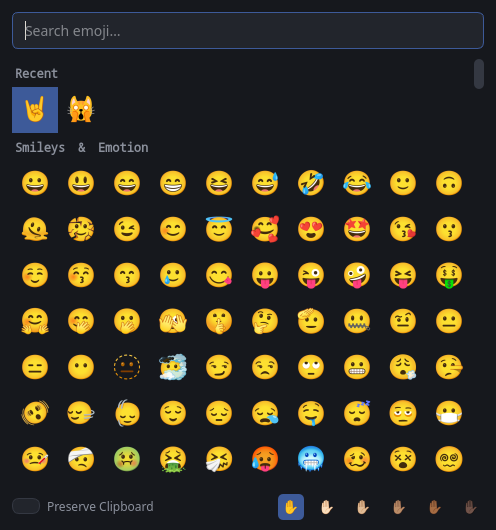

# emoji-insert

A small, keyboard-friendly emoji picker for KDE Plasma on Wayland. Press your shortcut, find an emoji, and it's pasted into the window you were using.



> [!NOTE]
> **AI disclaimer:** This project was built with AI assistance, using Claude Code. The code and documentation may contain mistakes, so review the script before you run it.
>
> **Testing:** It has only been tested on CachyOS (Arch-based) with Plasma 6.

## Features

- Dark grid of emojis, without names, grouped by Unicode category
- **Recent** group with your last 30 emojis
- Search by name as soon as you start typing
- Skin tone selector that applies to every emoji that supports it
- Optional **Preserve Clipboard** mode that restores what you had copied
- One Python file, with no background service of its own

## Requirements

- KDE Plasma on Wayland
- Python 3.11 or newer, at `/usr/bin/python3`
- [PySide6](https://doc.qt.io/qtforpython-6/)
- [wl-clipboard](https://github.com/bugaevc/wl-clipboard)
- [ydotool](https://github.com/ReimuNotMoe/ydotool), with `ydotoold` running
- Noto Color Emoji font
- `notify-send`, for error messages (optional)
- [kdotool](https://github.com/jinliu/kdotool), for pasting into terminals (optional, see [Pasting into terminals](#pasting-into-terminals))

Package names below are for Arch; other distributions may name them differently.

## Installation

1. Install the dependencies:

   ```sh
   sudo pacman -S pyside6 wl-clipboard ydotool noto-fonts-emoji libnotify
   ```

2. Start `ydotoold`:

   ```sh
   systemctl --user enable --now ydotool
   ```

   `ydotoold` needs write access to `/dev/uinput`. If it can't get it, one common fix is to add yourself to the `input` group and log in again. Be aware that this also lets your user's programs read input devices, including the keyboard.

   ```sh
   sudo usermod -aG input "$USER"
   ```

3. Install the script:

   ```sh
   install -Dm755 emoji-insert ~/.local/bin/emoji-insert
   ```

4. Download the emoji list from unicode.org. This is the only time the script uses the network, and you can run it again whenever you want newer emojis.

   ```sh
   ~/.local/bin/emoji-insert --update-data
   ```

5. Add a shortcut in **System Settings → Keyboard → Shortcuts → Add New → Command or Script**, using this command:

   ```
   ~/.local/bin/emoji-insert
   ```

## Usage

Press your shortcut with the cursor where you want the emoji.

| Input | Action |
| --- | --- |
| Type | Search by name |
| Arrow keys, Page Up, Page Down | Move through the grid |
| Enter or click | Insert the emoji |
| Esc or click another window | Cancel |

Search matches the start of words, so `cat` finds "cat face" but not "application". Every word you type has to match.

### Preserve Clipboard

| Toggle | What happens to the clipboard |
| --- | --- |
| Off (default) | The emoji stays on the clipboard after it's pasted |
| On | What you had copied before comes back after the paste |

The toggle and the skin tone are remembered between uses.

## Limitations

- **Pasting into terminals:** see [below](#pasting-into-terminals).
- **Restoring the clipboard:** only one format comes back. Rich text returns as plain text, and content offered as both text and image returns as text.
- **Paste timing:** pasting and restoring use short fixed delays. A very slow app could paste the wrong content when Preserve Clipboard is on. You can adjust `FOCUS_DELAY` and `RESTORE_DELAY` at the top of the script.
- **Skin tones:** mixed-tone pairs, such as a couple with two different tones, aren't available.
- **Window position:** KWin decides where the window opens. A KWin window rule can change this.

## Pasting into terminals

Most terminals paste with Ctrl+Shift+V rather than Ctrl+V. The script can only detect a terminal if `kdotool` is installed, which is available from the AUR on Arch. Without it, every window gets Ctrl+V, so the emoji won't paste into a terminal. It's still on the clipboard unless Preserve Clipboard is on.

To add a terminal, put its window class in `TERMINALS` at the top of the script.

## Troubleshooting

**Nothing happens when I press the shortcut.** Run `~/.local/bin/emoji-insert` from a terminal to see the error.

**"Couldn't paste automatically".** `ydotoold` probably isn't running. Check with `systemctl --user status ydotool`. The emoji is left on the clipboard so you can paste it yourself.

**"Emoji list missing".** Run `~/.local/bin/emoji-insert --update-data`.

**Backspace turns an emoji into a different one.** Some emojis are several characters joined together. For example, 🐈‍⬛ is 🐈, an invisible joiner and ⬛. Many apps delete one character at a time, so the black cat becomes a regular cat first. The app you're typing in controls this. Selecting the emoji and then deleting it usually removes it in one step.

## Files

| Path | Contents |
| --- | --- |
| `~/.local/share/emoji-insert/emojis.tsv` | Emoji list, created by `--update-data` |
| `~/.local/share/emoji-insert/recent.txt` | Recently used emojis |
| `~/.local/share/emoji-insert/emojis.txt` | Your own extra search words (optional) |
| `~/.config/emoji-insert/settings.json` | Toggle and skin tone settings |

`XDG_DATA_HOME` and `XDG_CONFIG_HOME` are respected.

### Adding search words

The Unicode list only provides names, so searches match those by default. To add your own words, create `emojis.txt` with one emoji per line, then run `--update-data` again:

```
🤘 metal rock
🐱 kitty
```

## Uninstalling

Remove the shortcut from System Settings, then delete the script and its data:

```sh
rm ~/.local/bin/emoji-insert
rm -r ~/.local/share/emoji-insert ~/.config/emoji-insert
```

